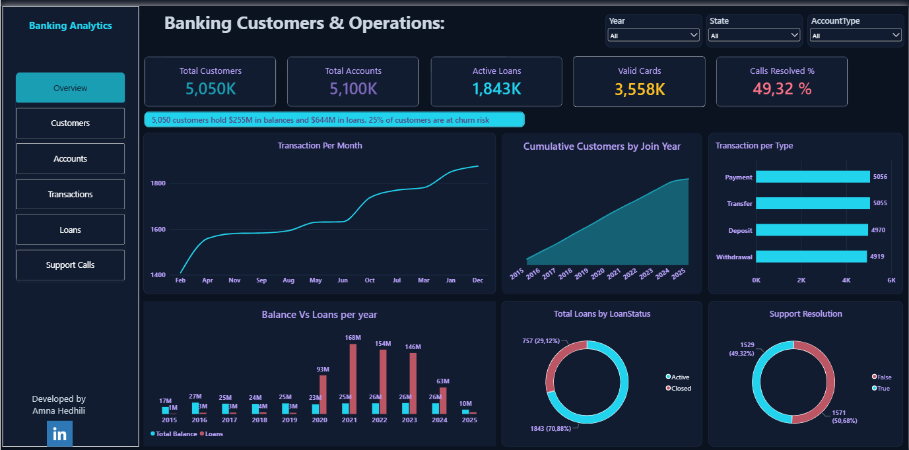
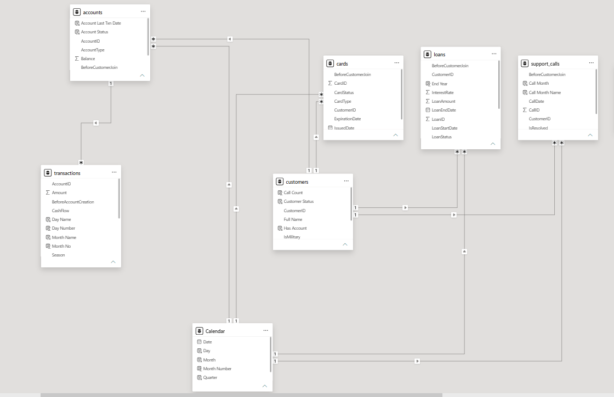
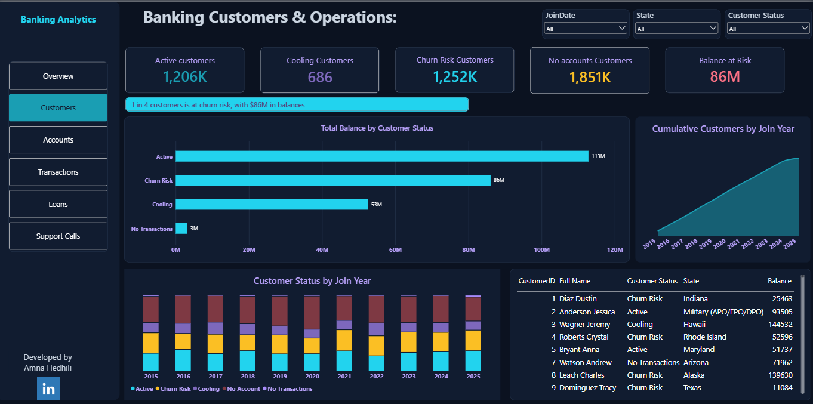
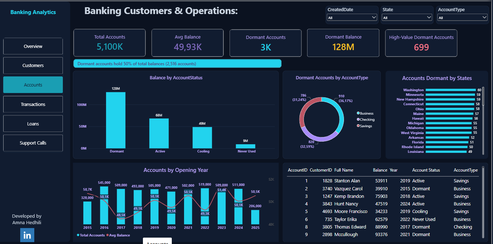
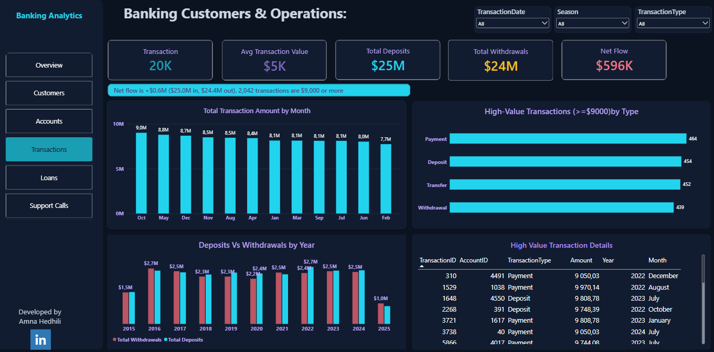
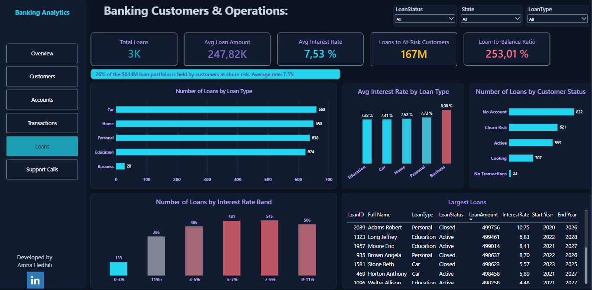
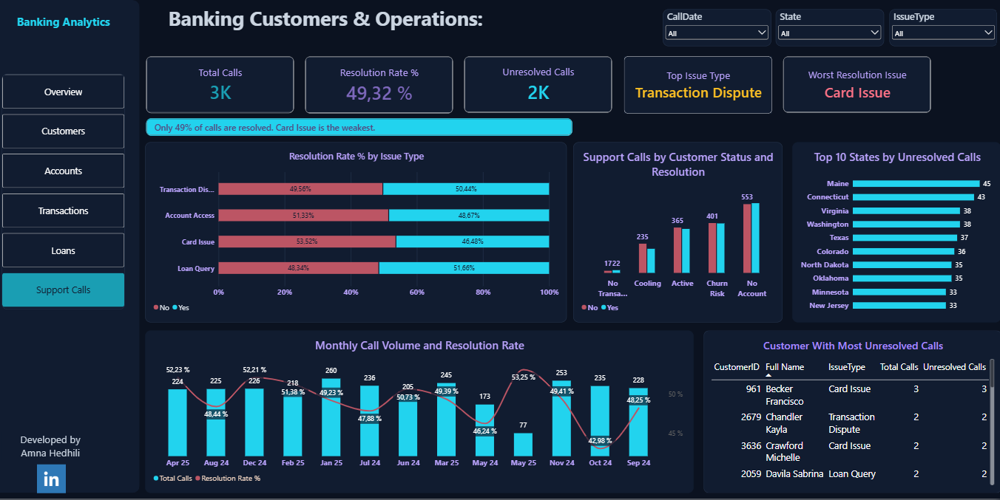

# 🏦 Banking Customer & Operations Analytics

An end-to-end analytics project: raw banking files → data cleaning in **Python** → transformation in **Power Query** → star-style data model with **DAX** → a 6-page interactive **Power BI** dashboard.




---

## 📌 Project Overview

A retail bank needs one clear view of its **customers, accounts, transactions, loans, cards and support calls** to answer two questions:

1. **How is the business performing?** (growth, volumes, balances, portfolio)
2. **Where is the risk?** (dormant accounts, customers drifting away, unresolved support issues)

This project builds the full pipeline to answer both, and turns it into a dashboard that a manager can filter by **year, state, account type, loan type, issue type and more**.

---

## 🗂️ Data

| Table | Rows | Description |
|-------|-----:|-------------|
| `customers` | 5,050 | Customer ID, name, join date, state, military flag |
| `accounts` | 5,100 | Account type (Business, Checking, Savings), balance, created date |
| `transactions` | 20,000 | Deposit, Withdrawal, Payment, Transfer (May 2022 – May 2025) |
| `loans` | 2,600 | Loan type, amount, interest rate, start/end date, status |
| `cards` | 4,000 | Debit, Credit, Prepaid; issue/expiry date; status |
| `support_calls` | 3,100 | Issue type, call date, resolved yes/no |

<!-- Add the data source here (e.g. synthetic dataset / Kaggle link) -->

---

## 🛠️ Tools

**Python** (pandas, Jupyter) · **Power Query** · **Power BI Desktop** · **DAX** · **GitHub**

---

## 🔄 Workflow

### 1️⃣ Data cleaning in Python — `banking_cleaning.ipynb`
- Data quality checks (shape, types, summary statistics)
- Date columns converted to proper date types
- Missing values handled 
- Duplicates detected and removed
- First exploratory charts to understand distributions
- Cleaned files exported to `Data/clean/`
- Quality flags created instead of deleting rows: `BeforeCustomerJoin` (accounts, cards, loans, support calls) and `BeforeAccountCreation` (transactions)

### 2️⃣ Transformation in Power Query
- Loaded the 6 cleaned CSV files
- Set data types for every column
- Merged `FirstName` and `LastName` into a **Full Name** column
- Fixed the decimal separator in `Amount` (text → number) so values are read correctly in the local regional settings
- Built a **Calendar** date table (2015–2025)

### 3️⃣ Data model
`customers` is the central dimension. Each fact table connects to it (directly or through accounts):

```
transactions ──(AccountID)──> accounts ──(CustomerID)──> customers
cards         ──(CustomerID)───────────────────────────> customers
loans         ──(CustomerID)───────────────────────────> customers
support_calls ──(CustomerID)───────────────────────────> customers
```

All relationships are **many-to-one, single direction**. Measures are organised in dedicated tables (`Accounts Measures`, `Loans Measures`, `Calls Measures`, `Transactions Measures`, `customers measures`, `Cards Measures`, `Measures Table`).




### 4️⃣ DAX

**Customer and account health (calculated columns)**

The reference date is the latest transaction in the data (`11 May 2025`), so the status stays consistent when the data refreshes.

```dax
Account Status =
VAR RefDate = [Reference Date]
VAR LastTxn = Accounts[Account Last Txn Date]
RETURN
    SWITCH (
        TRUE (),
        ISBLANK ( LastTxn ), "Never Used",
        LastTxn >= RefDate - 90, "Active",
        LastTxn >= EDATE ( RefDate, -6 ), "Cooling",
        "Dormant"
    )
```

```dax
Customer Status =
VAR RefDate = [Reference Date]
VAR LastTxn = Customers[Last Txn Date]
VAR HasAccount = CALCULATE ( COUNTROWS ( Accounts ) ) > 0
RETURN
    SWITCH (
        TRUE (),
        NOT HasAccount, "No Account",
        ISBLANK ( LastTxn ), "No Transactions",
        LastTxn >= RefDate - 90, "Active",
        LastTxn >= EDATE ( RefDate, -6 ), "Cooling",
        "Churn Risk"
    )
```

**Key measures**

| Measure | Logic |
|---------|-------|
| `Net Flow` | `[Total Deposits] - [Total Withdrawals]` |
| `High-Value Transactions` | Transactions with `Amount >= 9000` |
| `High-Value Dormant Accounts` | Dormant or Never Used accounts with balance ≥ 75,000 |
| `Balance at Risk` | Total balance of customers with status *Churn Risk* |
| `Loans to At-Risk Customers` | Loan amount held by *Churn Risk* customers |
| `Loan-to-Balance Ratio` | `DIVIDE ( [Loans], [Total Balance] )` |
| `Resolution Rate %` | `DIVIDE ( [Resolved Calls], [Total Calls] )` |
| `Top Issue Type` / `Worst Resolution Issue` | `MAXX ( TOPN ( 1, VALUES ( IssueType ), … ) )` |
| `Customers to Date` | Cumulative customers using `REMOVEFILTERS` on the calendar |

**Time intelligence:** year-over-year comparison with `SAMEPERIODLASTYEAR` (`Ly_*`, `Var_*`, `Var_*%` measures)

**Other:** a disconnected `Risk Metrics` table with a `SWITCH`-based `Risk Value` measure; `Rate Band` calculated column (0-3%, 3-5%, 5-7%, 7-9%, 9-11%, 11%+) for loan analysis.

### 5️⃣ Dashboard (6 pages)

Custom dark high-contrast theme, consistent layout on every page: **KPI cards on top**, charts and a detail table below, **3 slicers** top right and a **page navigator** on the left.

| Page | KPIs | Main visuals |
|------|------|--------------|
| **Overview** | Customers, Accounts, Active Loans, Valid Cards, Resolution Rate % | Transactions per month, cumulative customers by join year, transactions per type, balance vs loans per year, loan status, support resolution |
| **Customers** | Active, Cooling, Churn Risk, No-Account customers, Balance at Risk | Balance by customer status, status by join year (100% stacked), cumulative customers, customer detail table |
| **Accounts** | Total Accounts, Avg Balance, Dormant Accounts, Dormant Balance, High-Value Dormant | Balance by account status, dormant accounts by type and by state, accounts by opening year, account detail table |
| **Transactions** | Transactions, Avg Value, Deposits, Withdrawals, Net Flow | Amount by month, high-value transactions by type, deposits vs withdrawals by year, high-value transaction table |
| **Loans** | Total Loans, Avg Loan Amount, Avg Interest Rate, Loans to At-Risk Customers, Loan-to-Balance Ratio | Loans by type, interest rate by type, loans by customer status, loans by rate band, largest loans table |
| **Support Calls** | Total Calls, Unresolved Calls, Resolution Rate %, Top Issue Type, Worst Resolution Issue | Resolution rate by issue type, calls by customer status, top 10 states by unresolved calls, monthly volume and resolution rate, customers with most unresolved calls |

Screenshots:







---

## 💡 Key Insights

*(calculated with the dashboard's own logic; reference date 11 May 2025)*

- **Half of the accounts are dormant.** 2,516 of 5,100 accounts (49%) have had no transaction in the last 6 months, and they hold **$128.4M of the $254.7M total balance (50%)**.
- **699 high-value accounts (≥ $75K) are dormant or never used**: a clear target for a re-engagement campaign.
- **A quarter of customers are at risk.** 1,252 customers (25%) are in *Churn Risk* and hold **$86.1M in balances (33.8% of the total)**. Only 1,206 customers (24%) are *Active*.
- **37% of customers (1,851) have no account**, so there is room for cross-selling.
- **Loan exposure to at-risk customers is $167.4M, 26% of the $644.3M loan portfolio.** Active loans: 1,843 of 2,600, average amount $247.8K, average rate 7.5%.
- **Cash flow is slightly positive:** $24.98M deposited vs $24.38M withdrawn (net +$0.6M) across 20,000 transactions. All four transaction types have a very similar share (about 25% each), and 2,042 transactions are high-value (≥ $9,000).
- **Only 49% of support calls are resolved.** 1,571 of 3,100 calls are still unresolved. *Transaction Dispute* is the most frequent issue (803 calls) and *Card Issue* has the lowest resolution rate (46.5%).
- **89% of cards are valid** (3,558 of 4,000); 442 are expired.

---

## ⚠️ Data Quality Notes

- A large share of records carry the flag `BeforeCustomerJoin` (2,488 accounts, 986 cards, 780 loans, 137 calls) and 3,172 transactions are dated before their account was created. These rows were **flagged, not deleted**, so they can be filtered or investigated.
- `Customers by State` includes a *Military (APO/FPO/DPO)* group (531 customers), the largest "state".

---

## 📁 Repository Structure

```
├── Data/
│   ├── raw/
│   └── clean/            # cleaned CSV files used by Power BI
├── Cleaning/
│   └── banking_cleaning.ipynb
├── Dashboard/
│   ├── Banking_Operations.pbix
│   └── Images/
└── README.md
```

---

## ▶️ How to Run

1. Clone the repository
   ```bash
   git clone https://github.com/AMNA-HEDHILI/Banking-Operations-Dashboard.git
   ```
2. Install the requirements: `pip install pandas matplotlib jupyter`
3. Run `notebooks/banking_cleaning.ipynb` to generate the files in `Data/clean/`
4. Open `Dashboard/Banking_Operations.pbix` in Power BI Desktop, then update the **source folder path** (**Home → Transform data → Data source settings**) so it points to your local `Data/clean` folder

---

## 🚀 Next Steps

- Publish the dashboard online with a public link, so anyone can explore it without installing Power BI
- Add an AI assistant, so users can ask questions in plain language and get a short summary of the data.

---

## 👤 Author

**Amna Hedhili**: Data & BI | Verona, Italy
[LinkedIn](https://www.linkedin.com/in/amna-hedhili-07185a201/) · [GitHub](https://github.com/AMNA-HEDHILI)
